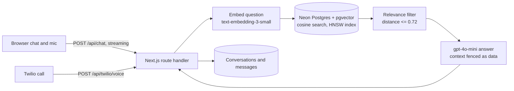

# Callwise

AI customer support that businesses can train on their own documents. Sign up, create an assistant, upload your docs, and get a chat and voice assistant that answers using only your content. An optional phone line can answer calls with the same assistant.

**Live demo:** https://callwise-three.vercel.app/demo (a fictional outdoor-gear store, no sign-up needed)

This is a portfolio project. It is built and operated like a small production service: tests, CI, versioned migrations, a health check, an uptime check, decision records and a runbook. The plan it followed is in [docs/ROADMAP.md](docs/ROADMAP.md).

## Features

- **Multi-tenant assistants:** each account creates and manages its own assistants; nothing is shared between businesses.
- **Bring your own documents:** upload PDF, Word (.docx), text, Markdown or CSV files, or paste text. Files are parsed, split along headings and paragraphs, embedded and stored in Postgres with pgvector. A document and its chunks are saved in one transaction.
- **Grounded answers:** each question retrieves the closest chunks, drops any that are too far from the question, and the model answers only from what is left. With nothing relevant it says it is not sure and offers a human.
- **Streaming chat:** responses stream token by token via the Vercel AI SDK. Earlier turns are read from the database, not trusted from the browser.
- **Voice in the browser:** speech input and spoken replies use the Web Speech API, so voice needs no paid speech vendor. Best supported in Chrome.
- **Optional phone line:** a Twilio number routes calls to the same retrieval pipeline. It is off unless `TWILIO_AUTH_TOKEN` is set, and the deploy page shows the webhook URL only when it is on. See [docs/RUNBOOK.md](docs/RUNBOOK.md).
- **App shell and dashboard:** a sidebar layout with live stats, a 14-day activity chart, a setup checklist and recent conversations, plus per-assistant Overview, Knowledge, Test, Conversations, Deploy and Settings tabs.
- **Deploy anywhere:** every assistant gets a public chat page, a one-line website chat bubble (`widget.js`) and an iframe embed.
- **Auth and account:** email and password sign-up with Auth.js (server actions, bcrypt-hashed passwords, rate-limited attempts), session-aware navigation, and protected routes that return you to where you were going. Account settings cover profile, password change, sign out of all devices (server-side session revocation), data export and account deletion.
- **Conversations inbox:** filter by assistant, channel and date range, search message text, load more, and delete conversations.
- **Abuse protection:** Twilio request signatures are verified, chat and uploads are rate limited (Postgres-backed counters), and input, history and output sizes are capped.

## Architecture



| Layer | Choice |
|---|---|
| Framework | Next.js 16 (App Router), React 19, TypeScript, Tailwind CSS 4, shadcn/ui |
| Database | Postgres + pgvector on Neon, accessed with Drizzle ORM, schema versioned in `drizzle/` |
| AI | OpenAI embeddings and chat completions via the Vercel AI SDK |
| Auth | Auth.js (NextAuth v5), credentials provider, JWT sessions |
| Voice | Web Speech API (browser); Twilio `<Gather>` / `<Say>` for phone |
| Delivery | Vercel (deploys from `main`), GitHub Actions for CI and uptime |

Decisions are recorded in [docs/adr](docs/adr):
[pgvector for retrieval](docs/adr/0001-pgvector-for-retrieval.md),
[session revocation](docs/adr/0002-session-revocation.md),
[Twilio Gather for the phone line](docs/adr/0003-twilio-gather-for-phone.md) and
[Postgres-backed rate limiting](docs/adr/0004-postgres-rate-limiting.md).

### Project layout

```
src/
  app/
    (marketing)/    landing page and public demo
    (auth)/         login and signup (redirect away when logged in)
    (app)/          authenticated app: dashboard, assistants/[id]/*, conversations
    a/[slug]        public chat page for an assistant
    embed/[slug]    embeddable chat used by the chat bubble and iframe
    api/            chat, documents, health, twilio and auth route handlers
  components/       UI (shadcn/ui on Base UI), chat widget, dashboard pieces
  lib/
    db/             Drizzle schema and client
    rag/            chunking, embedding, retrieval, prompt building, ingest, file text extraction
    auth/           Auth.js config and login/signup server actions
    actions/        server actions for assistants
    data/           dashboard and conversation queries
  proxy.ts          route protection with a return-to-page redirect
drizzle/            versioned SQL migrations
eval/               evaluation questions and the longer test corpus
scripts/            seed, evaluation, migration baseline and uptime check
docs/               roadmap, runbook and decision records
public/widget.js    the embeddable chat bubble
```

## Running locally

Requires Node 20+ (CI uses 22), a Neon Postgres database, and an OpenAI API key.

```bash
npm install
cp .env.example .env.local   # then fill in the values
```

Apply the migrations (they enable pgvector and create the tables), then start the app:

```bash
npm run db:migrate
npm run dev
```

Open http://localhost:3000, create an account, add an assistant, paste in a document, and ask it a question.

### Environment variables

| Variable | Purpose |
|---|---|
| `DATABASE_URL` | Neon Postgres connection string |
| `OPENAI_API_KEY` | Embeddings and chat completions |
| `AUTH_SECRET` | Auth.js session signing (`npx auth secret`) |
| `TWILIO_AUTH_TOKEN` | Optional. Switches the phone line on: the voice webhook answers 503 without it and uses it to verify Twilio's request signatures |

## Testing and CI

```bash
npm run lint
npm run typecheck
npm test          # Vitest: unit tests and route tests with the database and AI SDK mocked
npm run build
```

GitHub Actions runs all four on every push to `main` and every pull request (`.github/workflows/ci.yml`). The build runs with placeholder variables and no database, because the database client connects lazily.

The route tests cover chat, the Twilio webhook and document upload, including signature checks, size and rate limits, ownership checks and the failure paths. Where a test found a bug it was fixed in its own commit; for example, accented characters used to split slugs and comma-separated forwarded headers made the Twilio signature check throw.

## Database migrations

The schema lives in `src/lib/db/schema.ts` and is versioned as SQL files in `drizzle/`. The baseline (`0000_baseline.sql`) enables the `vector` extension and creates every table; `0001` adds an HNSW cosine index on `chunks.embedding` to match the `<=>` operator the search uses.

- Change the schema, then run `npm run db:generate` to create the next migration and commit it.
- Apply migrations with `npm run db:migrate` (it uses `DATABASE_URL`).
- Try every change on a Neon branch of the production database first, and check that `npx drizzle-kit generate` reports no drift.
- `db:push` is for throwaway local databases only; never run it against production.

A database whose tables were created before migrations existed is brought in line once with `DATABASE_URL=<url> node scripts/baseline-migration.mjs`. It records the baseline as applied without running it.

## Health and uptime

`GET /api/health` runs a database round trip and reports which configuration groups are present as booleans, never values. `?deep=1` also makes one real OpenAI call (limited to 10 per hour per IP), because a configuration check cannot tell a present key from an expired one. A scheduled GitHub Action (`.github/workflows/uptime.yml`) checks `/demo` and `/api/health` every 15 minutes and keeps a single `uptime` issue open while the site is down. What to do when it fires is in [docs/RUNBOOK.md](docs/RUNBOOK.md).

## Evaluation

Retrieval quality is measured, not assumed. Both scripts read `OPENAI_API_KEY` (and the first also `DATABASE_URL`) from `.env.local`, and neither writes to a database.

**Demo knowledge base** (`npm run eval`): 20 answerable and 8 unanswerable questions run through the same pgvector query the app uses, against the 7 demo documents. Run on 2026-11-18:

| Metric | Result |
|---|---|
| hit@1: best chunk is from the right document | 19/20 (95%) |
| hit@5: right document in the top 5 | 20/20 (100%) |
| answered: some chunk passes the relevance threshold | 20/20 (100%) |
| declined: no chunk passes the threshold (unanswerable) | 6/8 (75%) |

Read these with care. The demo has only 7 chunks, so hit@5 is close to guaranteed. The two unanswerable questions that were not declined at retrieval ("Who founded Northwind Outfitters?" and a question about trails near Portland) share words with the documents, so a distance cut-off alone cannot separate them; the prompt tells the model to decline when the context does not answer the question, but the model's final answer is not part of this score. The 0.72 threshold was chosen from a different, earlier set of 22 questions, not from these.

**Chunking** (`npm run eval:chunking`): the demo documents are too short to tell chunkers apart, so this compares the old fixed 800-character chunker with 150 overlap against the structure-aware chunker on a longer five-document handbook (`eval/handbook`), in memory, with 27 answerable and 12 unanswerable questions. A hit means one of the top chunks contains the answer text. Run on 2026-11-18:

| | Fixed 800/150 | Structure-aware 800 |
|---|---|---|
| Chunks (mean size) | 15 (683 chars) | 26 (349 chars) |
| hit@1 | 24/27 (89%) | 26/27 (96%) |
| hit@3 | 26/27 (96%) | 27/27 (100%) |
| Unanswerable declined by the threshold | 6/12 (50%) | 5/12 (42%) |

The structure-aware chunker is what uploads use. It retrieves the answer more reliably, but the distance cut-off declined one more unanswerable question under the old chunker, a difference of one question out of twelve near the threshold. The 8 extra unanswerable questions were added after a first run with 4 showed that was too few to compare. This is a small, synthetic corpus: it shows the direction, not a benchmark.

## Status

Deployed on Vercel with Neon Postgres. Working end to end: sign-up, login, assistant management, file and text indexing, grounded chat with browser voice, and an optional phone line with call memory. Self-serve number provisioning per business is not built; the phone line is demonstrated with a single Twilio number on request.

## Seeding the demo

`node scripts/seed-demo.mjs` creates the fictional "Northwind Outfitters" business and its knowledge base used by the /demo page. It is safe to repeat; see [docs/RUNBOOK.md](docs/RUNBOOK.md).
